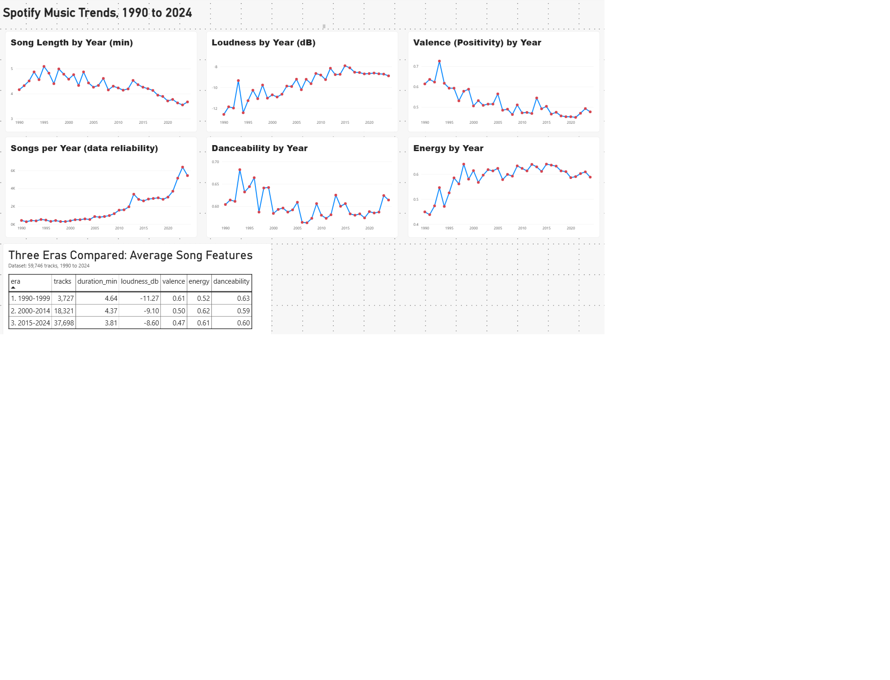

# Spotify Music Trends and Hit Profile Analysis (1990 to 2024)

An analysis of 59,746 Spotify tracks released from 1990 to 2024, built with SQL Server and Power BI.

## 1. Project overview

This project analyzes about 62,000 Spotify tracks to answer two questions:

1. **Problem 1, Trends:** How did the sound of songs change from 1990 to 2024?
2. **Problem 2, Hit profile:** How do the top 10% most popular songs differ from the rest?

**Tools:** SQL Server (SSMS 22), Power BI, GitHub.

## 2. Dataset

- **Source:** Spotify Tracks Dataset (Updated Every Week), Kaggle, by gauthamvijayaraj
- **Downloaded on:** 1 November 2026
- **Raw size:** 62,317 rows, years 1971 to 2024
- **Key columns:** year, popularity, danceability, energy, valence, loudness, tempo, acousticness, speechiness, duration_ms, key, mode

## 3. Data cleaning

| Step | What I did | Rows affected |
| --- | --- | --- |
| Missing audio features | Removed tracks with empty audio values | 401 |
| Duplicate tracks | Removed duplicate track_id, kept the most popular copy | 78 |
| Year filter | Kept 1990 to 2024 for analysis, because earlier years have too few songs | 2,093 outside the range |
| New columns | duration_min = duration_ms / 60000; is_hit = 1 if popularity is in the top 10% | n/a |

**Final rows used:** 61,839 after cleaning, of which 59,746 fall in 1990 to 2024 and are used for the analysis.

**Hit definition:** a track is a hit if its popularity is 45 or higher, the 90th percentile. After cleaning this gives 6,229 hits (10.1%) and 55,610 non-hits. Within 1990 to 2024 there are 6,088 hits and 53,658 non-hits.

**Why top 10%:** about 28% of tracks have popularity 0 and only about 1% reach 70, so a fixed cutoff of 70 would leave too few hits.

## 4. Problem 1: Trends by year (1990 to 2024)

**Question:** How did danceability, energy, valence, loudness, and song length change?

**Method:** Average of each feature per year, using GROUP BY year in SQL, then line charts in Power BI.

**Results:** average of each feature per era, using all songs in each era (3,727 tracks in 1990 to 1999, 18,321 in 2000 to 2014, 37,698 in 2015 to 2024).

| Feature | 1990-1999 | 2000-2014 | 2015-2024 | Change (first to last era) | Direction |
| --- | --- | --- | --- | --- | --- |
| Duration (min) | 4.64 | 4.37 | 3.81 | -0.83 | falling, mostly after 2015 |
| Loudness (dB) | -11.27 | -9.10 | -8.60 | +2.67 | rising, mostly before 2015 |
| Valence | 0.610 | 0.502 | 0.472 | -0.138 | falling |
| Energy | 0.521 | 0.616 | 0.608 | +0.087 | rose, then flat |
| Danceability | 0.631 | 0.593 | 0.596 | -0.035 | small dip, then flat |



Line charts by year for each feature, songs per year, and the three-era table. Loudness values are negative (dB).

### Verdict for Problem 1

Across three eras (1990-1999, 2000-2014, 2015-2024), songs in this dataset became louder, less positive in valence, and shorter. Loudness and valence changed mostly between the 1990s and 2000-2014 (loudness -11.27 to -9.10 dB, valence 0.610 to 0.502). Song length changed little at first (4.64 to 4.37 minutes) and dropped faster in 2015 to 2024 (3.81 minutes). Energy rose between the 1990s and 2000-2014 (0.521 to 0.616) and then stayed flat, while danceability dipped slightly (0.631 to 0.593) and also stayed flat. Individual songs vary widely within each era, so these are shifts in averages. The dataset has about ten times more songs from 2015 to 2024 than from the 1990s, and older songs may be those still streamed today, so the trends describe this dataset and may not represent all music.

**Final verdict:** from the 1990s to the 2010s and 2020s, the average song in this dataset got louder and less positive, and since 2015 it has also become noticeably shorter.

## 5. Problem 2: Hit vs non-hit profile

**Question:** How do the top 10% most popular songs differ in sound from the other 90%?

**Method:** Compare average features for is_hit = 1 versus is_hit = 0, then calculate the hit rate inside feature bands, such as loudness bands.

**Results:** average of each feature for hits (6,088 tracks) and non-hits (53,658 tracks), 1990 to 2024.

| Feature | Hits | Non-hits | Gap | Meaningful? |
| --- | --- | --- | --- | --- |
| Loudness (dB) | -6.38 | -9.21 | +2.83 | yes (largest) |
| Energy | 0.682 | 0.596 | +0.086 | yes |
| Acousticness | 0.264 | 0.364 | -0.100 | yes (hits are less acoustic) |
| Danceability | 0.634 | 0.593 | +0.041 | moderate |
| Valence | 0.521 | 0.486 | +0.035 | small |
| Tempo (BPM) | 120.2 | 117.7 | +2.5 | small |
| Duration (min) | 3.88 | 4.05 | -0.17 | small |
| Speechiness | 0.086 | 0.088 | -0.002 | none |

**Hit rate by loudness band:** 2.6% for very quiet songs (below -12 dB), 6.5% for quiet (-12 to -9 dB), 10.0% for loud (-9 to -6 dB), and 16.7% for very loud songs (above -6 dB). A very loud song is about six times as likely to be a hit as a very quiet one. As a check, the gaps between hits and non-hits were about the same inside 1990 to 2014 and inside 2015 to 2024 (loudness +2.73 and +2.81 dB), so the result is not caused by mixing eras.


Hit rate by loudness band, sound features of hits vs non-hits, and the comparison table.

### Verdict for Problem 2

Hit songs (the top 10% by popularity, score 45 or higher) tend to be louder (-6.38 vs -9.21 dB), more energetic (0.682 vs 0.596), and less acoustic (0.264 vs 0.364) than non-hits, with slightly higher danceability (0.634 vs 0.593). Valence, tempo, and song length differ only slightly, and speechiness does not differ. These are differences in averages and the two groups overlap, so sound neither guarantees nor rules out a hit. They are associations, not causes, and factors like artist fame, marketing, and playlist placement are not in this dataset.

**Final verdict:** the typical hit in this dataset is louder, more energetic, and less acoustic than other songs, but sound alone does not separate hits from non-hits.

## 6. Why sound alone does not explain hits

The dataset is a single snapshot with one popularity number per song. It does not contain artist fame, marketing, playlist placement, social media trends, or release timing. So this project can describe what hits sound like, but it cannot show why a particular song became popular. These factors are the most likely explanations for songs that sound like hits but are not popular.

## 7. Limitations

1. The dataset has far more recent songs than older ones (415 tracks in 1990 versus 6,385 in 2023), so early years are less reliable and trends may reflect which songs were collected.
2. Popularity is based on plays and recency, so newer songs score higher and older songs may appear only if they are still streamed.
3. Between 13.6% and 48.4% of songs per year have popularity 0, so average popularity is not used to compare years. A top-10% hit definition was used instead.
4. Audio features are Spotify's estimates of sound, not direct measurements of how listeners feel.
5. The language column was excluded because its labels are unreliable (for example, some Hindi songs are tagged as Korean, and about 21% are Unknown).
6. Track count and the share of zero-popularity songs both jump in 2013, which suggests a batch of obscure songs entered the dataset rather than a change in music.
7. The source updates weekly, so results may differ on a later download. Data downloaded on 1 November 2026.

## 8. Key takeaways

1. Songs became shorter, louder, and less positive: average length fell from 4.64 to 3.81 minutes and loudness rose from -11.27 to -8.60 dB between the 1990s and 2015 to 2024.
2. Most of the shift in loudness, energy, and mood happened between the 1990s and 2000-2014, while the drop in song length came mostly after 2015.
3. Hits are louder, more energetic, and less acoustic than non-hits, and this holds within both 1990 to 2014 and 2015 to 2024.
4. Hit rate rises from 2.6% for very quiet songs to 16.7% for very loud ones, but 83% of very loud songs are still not hits, so a playlist team could use loudness and energy to screen tracks while remembering that sound is only part of the picture.

## 9. Repository structure

```
spotify-hit-analysis/
├── sql/
│   └── queries.sql
├── dashboard/
│   ├── spotify_dashboard.pbix
│   └── screenshots/
│       ├── trends_page.png
│       └── hit_profile_page.png
└── README.md
```

## 10. How to reproduce

1. Download the dataset from Kaggle (see section 2).
2. Import the CSV into SQL Server with Import Flat File (use nvarchar(max) for artist_name).
3. Run the cleaning script in `sql/queries.sql`.
4. Run the trend and hit-profile queries in the same file.
5. Open `dashboard/spotify_dashboard.pbix` in Power BI Desktop and refresh the data from your SQL Server.
